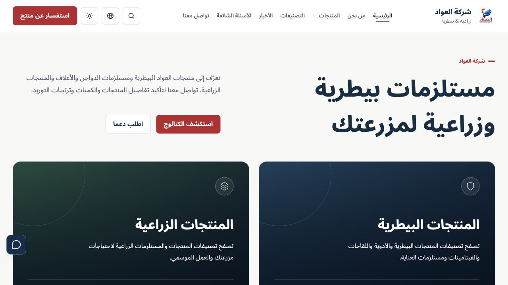
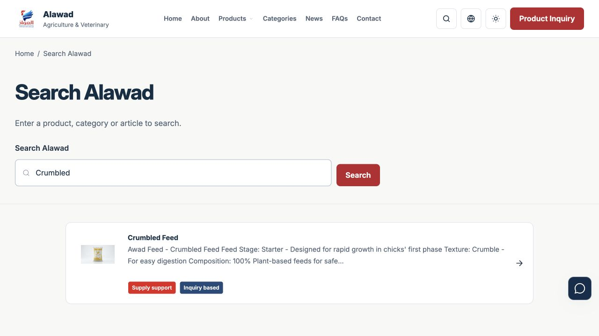
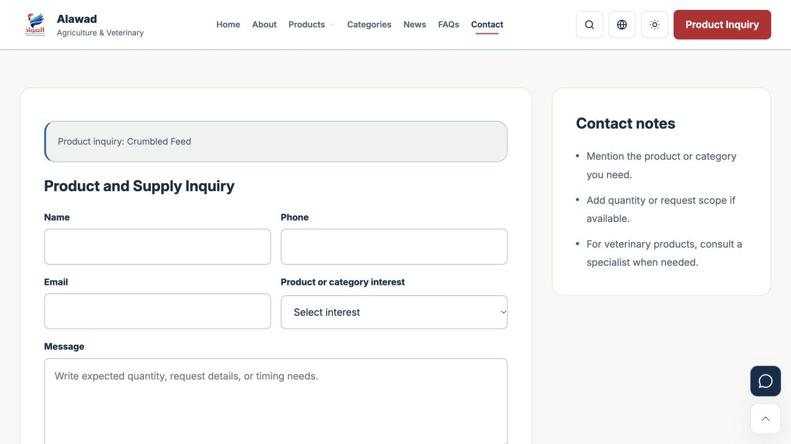
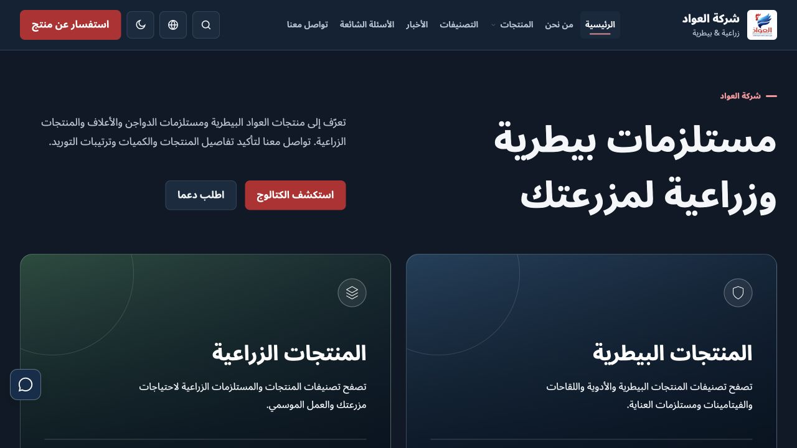

# Alawad Company — شركة العواد — عرض المشروع

[English](README.md) · [Türkçe](README.tr.md) · [العربية](README.ar.md)

**مشروع لعميل · Abdullah Aalawad**

موقع للمستلزمات الزراعية والبيطرية يربط تصفح الكتالوج باستفسارات تحتفظ بسياق المنتج، مع إدارة محتوى عبر الويب بالعربية والإنجليزية.

## من منظور العميل

عرض مجموعة متنوعة من المستلزمات بصورة واضحة وربط صفحة المنتج باستفسار مفيد. هذا الاحتياج مستنتج من المسار المنفّذ، وليس من مقابلة مع العميل أو قياس سابق للتحويل أو ورشة اكتشاف موثقة.

تنظيم المنتجات ضمن تصنيفات، وربط البحث والتفاصيل بخطوة استفسار تحتفظ بسياق المنتج، وإدارة المحتوى العام من واجهة إدارية مشتركة.

استعرض تصنيفاً أو ابحث → افتح تفاصيل المنتج → انتقل إلى استفسار المنتج → أدخل تفاصيل الاحتياج ليراجعها الفريق

## الواجهات المنجزة

- موقع عام يضم الرئيسية والكتالوج والتصنيفات والبحث وتفاصيل المنتجات
- نموذج استفسار مرتبط بالمنتج ومنطق حفظ ومراجعة جرى التحقق منه في الشيفرة
- إدارة الصفحات والكتالوج والأخبار والترجمات والفريق والمواقع والشارات
- عرض بالعربية والإنجليزية مع مظهرين فاتح وداكن وتنسيقات متجاوبة

نتيجة بحث مباشرة لمنتج Crumbled Feed المعروض في الكتالوج العام.

نموذج استفسار فارغ يحتفظ بسياق المنتج؛ لم يُرسل أي طلب.

## النهج التقني

تستخدم صفحات PHP المنشأة على الخادم نموذج محتوى علائقياً مشتركاً ووظائف إدارة قابلة لإعادة الاستخدام. تربط PDO التطبيق بتخزين متوافق مع MySQL، بينما تتولى CSS المخصصة وJavaScript تنسيق العرض والتفاعل. يسمح فصل السمات المشتركة عن المحتوى الخاص بكل لغة للواجهة العامة والإدارة بالعمل على السجلات نفسها. تجمع عملية حفظ المحتوى الكتابات المرتبطة ضمن معاملة قاعدة بيانات. وتطبق أهلية التصنيفات والبحث قواعد نشر متسقة. هذه اختيارات ظاهرة في التنفيذ؛ ولا تُنسب إلى ورشة اختيار تقنيات غير موثقة أو إلى ضمان سعة مستقبلية.

- نموذج محتوى علائقي مشترك مع حقول خاصة بكل لغة
- صفحات ينشئها الخادم وتدعمها تفاعلات JavaScript محددة
- استمرار سياق المنتج بين التفاصيل والاستفسار
- وحدات إدارة قابلة لإعادة الاستخدام مع بحث وتقسيم صفحات محدودين

## اللغة والتجربة

تُعرض العربية من اليمين إلى اليسار والإنجليزية من اليسار إلى اليمين، مع تنقل ومحتوى يراعيان اللغة. يتيح التطبيق التبديل بين المظهرين الفاتح والداكن من خلال عناصره الأصلية. فُحص العرض الإنجليزي المباشر ضمن نافذة متصفح بعرض 390 وارتفاع 844 بكسل، وتطابق عرض المستند مع النافذة دون تجاوز أفقي مقاس. هذا دليل محدود على الاستجابة، وليس اختباراً شاملاً للأجهزة. التركية لغة لهذه الحزمة التحريرية، ولا تعني دعم التطبيق لها. توجد آليات لإتاحة الوصول، دون ادعاء مطابقة رسمية لمعيار.

الرئيسية العربية باتجاه من اليمين إلى اليسار وبالمظهر الداكن المدمج.

## حقائق المشروع

- مشروع لعميل — Abdullah Aalawad
- يونيو–يوليو 2026: فترة المشروع المقدمة من صاحبه؛ لم يُثبت يوم الإطلاق
- قيد التشغيل — بحسب صاحب المشروع؛ جرى فحص الموقع العام في 16 نوفمبر 2026

طوّر المشروع Ragıp Mullamusa لدى Ideabat. يشمل النطاق المثبت الكتالوج العام والعرض بلغتين ونظام الإدارة المشترك. لا تُفترض ورش اكتشاف أو شروط تعاقدية أو أي عملية نقل للملكية.

القدرة المنجزة هي واجهة كتالوج واستفسارات مترابطة تدعمها إدارة المحتوى. الموقع قيد التشغيل. لا تتوفر نتائج تجارية مقاسة أو انخفاض مثبت في زمن الرد أو نتائج مبيعات.

## الروابط الرسمية

[Alawad Company](https://alawadco.com/)

## معرض Ideabat ودراسة الحالة

تم التحقق من الصفحات القائمة في 16 نوفمبر 2026. لم تُرفع هذه المراجعة أو تُنشر.

**معرض المشاريع:** [English](https://ideabat.com/portfolio/alawad-agriculture-supply-platform/) · [Türkçe](https://ideabat.com/tr/portfolio/alawad-agriculture-supply-platform/) · [العربية](https://ideabat.com/ar/portfolio/alawad-agriculture-supply-platform/)

**دراسة الحالة:** [English](https://ideabat.com/case-study/alawad-catalog-inquiry-management/) · [Türkçe](https://ideabat.com/tr/case-study/alawad-catalog-inquiry-management/) · [العربية](https://ideabat.com/ar/case-study/alawad-catalog-inquiry-management/)

## الملكية والمراجعة التقنية

يحتوي هذا المستودع على توثيق ومواد بصرية معتمدة، وليس إصداراً للشيفرة المصدرية للتطبيق. عرض المشروع من خلال Ideabat لا ينقل ملكية العميل. للاستفسارات المتعلقة بالتوظيف أو التعاون أو المراجعة التقنية، تواصل مع Ragıp Mullamusa عبر Ideabat. يتطلب الوصول إلى الشيفرة المملوكة للعميل إذناً مسبقاً من صاحب المشروع والالتزام بمتطلبات السرية المعمول بها. تُراجع الطلبات كلٌّ على حدة، ولا يُضمن إتاحة الشيفرة. لا يمنح هذا العرض أي ترخيص برمجي أو إذن بإعادة التوزيع.

Ragıp Mullamusa هو مؤسس [Ideabat](https://ideabat.com/). للاستفسارات ذات الصلة بالهندسة أو التوظيف أو التعاون، يُرجى استخدام [صفحة التواصل](https://ideabat.com/contact-us/) أو البريد [info@ideabat.com](mailto:info@ideabat.com).

