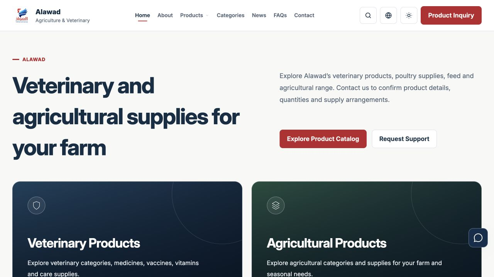
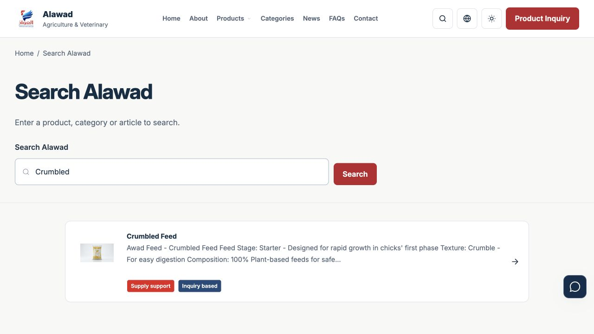
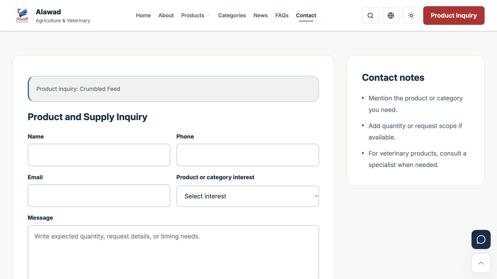
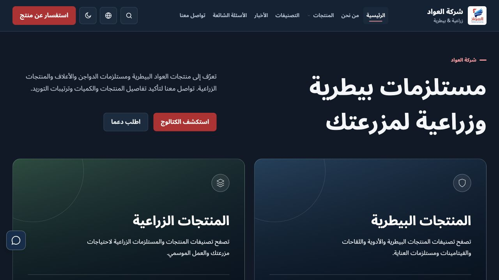

# Alawad Company — Project Showcase

[English](README.md) · [Türkçe](README.tr.md) · [العربية](README.ar.md)

**Client project · Abdullah Aalawad**

A bilingual agricultural and veterinary supply website that connects catalog browsing, product-aware inquiries and web content administration.

## Customer view

Make a varied supply range understandable and connect a product page to a useful inquiry. This challenge is inferred from the implemented workflow; no client interview, prior conversion baseline or documented discovery workshop is claimed.

Organize products into categories, combine search and product details with a contextual inquiry action, and maintain the public content through a shared administration interface.

Browse a category or search → Open product details → Follow the product inquiry action → Enter request details for staff review

## Delivered surfaces

- Public website with home, catalog, category, search and product screens
- Product-aware inquiry form and source-verified message persistence/review logic
- Web CMS for pages, catalog, news, translations, team, locations and badges
- English/Arabic presentation, light/dark controls and responsive styles

Live search result for the public Crumbled Feed product.

Empty inquiry form retaining product context; no request was submitted.

## Engineering view

Server-rendered PHP pages share a relational content model and reusable administration functions. PDO connects to MySQL-compatible storage; custom CSS and vanilla JavaScript provide layout and progressive interactions. Shared entity attributes are separated from language-specific content, allowing public and administrative views to use the same underlying records. Content saves group related database writes in a transaction. Category eligibility and public search apply consistent publication rules. This approach is visible in the implementation; no undocumented selection workshop, infrastructure scale or future capacity guarantee is claimed.

- Shared relational content model with localized fields
- Server-rendered pages enhanced by focused JavaScript interactions
- Consistent product context between detail and inquiry
- Reusable content administration and bounded search/pagination

## Language and experience

English uses left-to-right presentation; Arabic uses right-to-left presentation, with language-aware navigation and content. Light and dark themes are provided by the application’s own controls. The live English layout was inspected at a 390×844 browser viewport, where the document width matched the viewport without measured horizontal overflow. This is limited responsive evidence, not exhaustive device testing. Turkish is the language of one editorial version, not an implemented application language. Accessibility mechanisms are present, but no formal conformance claim is made.

Arabic right-to-left homepage using the application’s dark theme.

## Project facts

- Client project — Abdullah Aalawad
- June–July 2026, supplied project delivery window; exact launch date not established
- LIVE — supplied by the owner; public site observed on 16 November 2026

Developed by Ragıp Mullamusa at Ideabat. The verified scope includes the public catalog, bilingual presentation and shared administration implementation. No discovery workshop, contract terms or ownership transfer is inferred.

The delivered capability is a connected catalog and inquiry interface with supporting content administration. The site is live. No measured commercial improvement, response-time reduction or sales outcome is available.

## Official links

[Alawad Company](https://alawadco.com/)

## Ideabat portfolio and case study

Live pages verified on 16 November 2026. This documentation revision has not been uploaded or published.

**Portfolio:** [English](https://ideabat.com/portfolio/alawad-agriculture-supply-platform/) · [Türkçe](https://ideabat.com/tr/portfolio/alawad-agriculture-supply-platform/) · [العربية](https://ideabat.com/ar/portfolio/alawad-agriculture-supply-platform/)

**Case study:** [English](https://ideabat.com/case-study/alawad-catalog-inquiry-management/) · [Türkçe](https://ideabat.com/tr/case-study/alawad-catalog-inquiry-management/) · [العربية](https://ideabat.com/ar/case-study/alawad-catalog-inquiry-management/)

## Ownership and technical review

This repository contains documentation and approved visual material, not an application source release. Presentation through Ideabat does not transfer a client's ownership. For employment, collaboration or technical-review inquiries, contact Ragıp Mullamusa through Ideabat. Access to client-owned source requires prior permission from the project owner and compliance with applicable confidentiality requirements. Requests are reviewed individually; source access is not guaranteed. No software license or redistribution permission is granted by this showcase.

Ragıp Mullamusa is the founder of [Ideabat](https://ideabat.com/). For relevant engineering, employment or collaboration inquiries, use [the contact page](https://ideabat.com/contact-us/) or [info@ideabat.com](mailto:info@ideabat.com).
