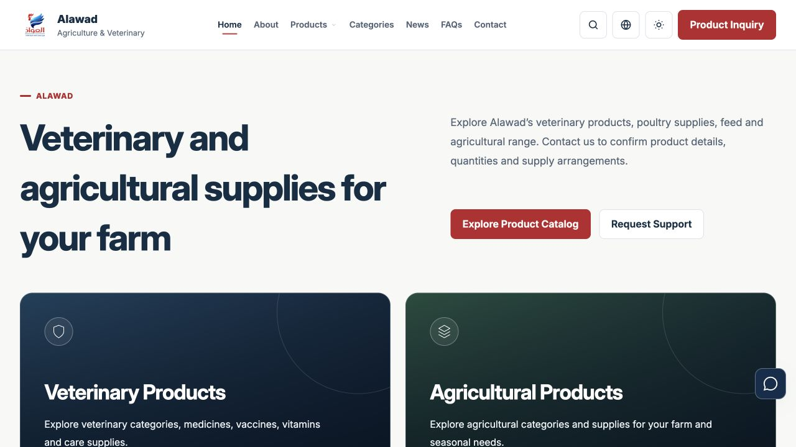
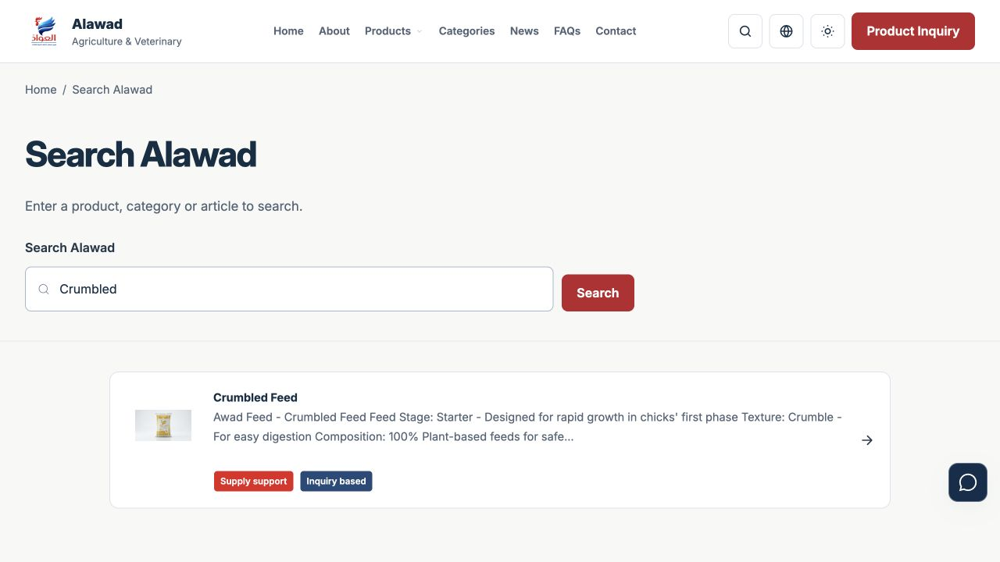
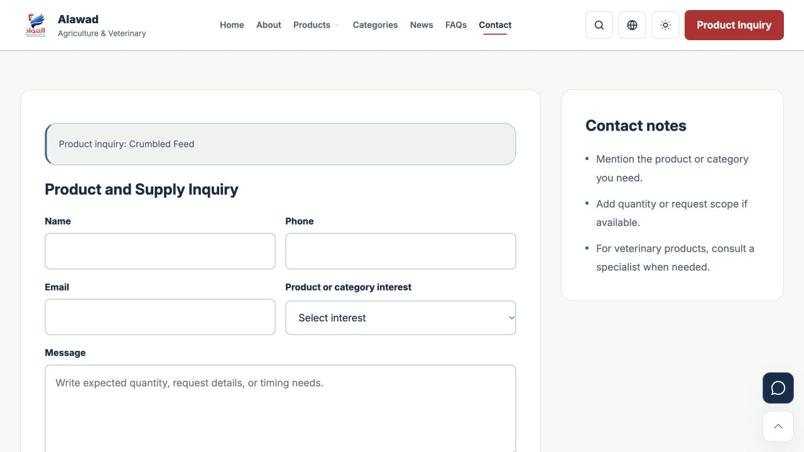
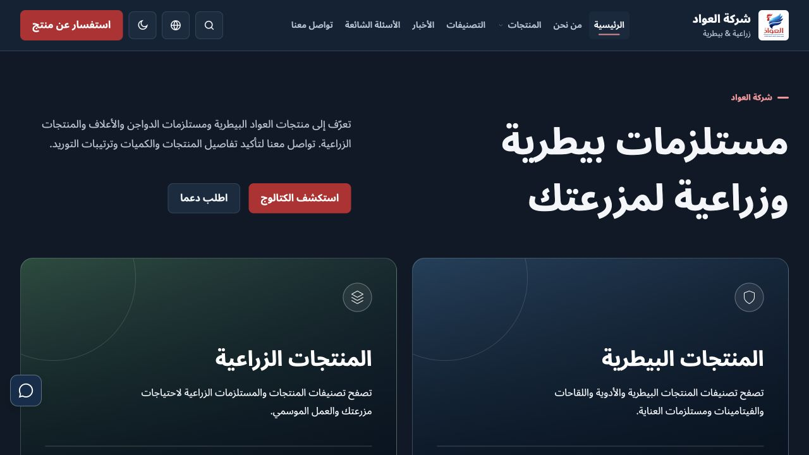

# Alawad Company — Proje Sunumu

[English](README.md) · [Türkçe](README.tr.md) · [العربية](README.ar.md)

**Müşteri projesi · Abdullah Aalawad**

Tarım ve veterinerlik ürünlerinin keşfini, ürün bağlamını koruyan talep formlarına ve web üzerinden içerik yönetimine bağlayan iki dilli site.

## Müşteri açısından

Geniş ürün çeşitliliğini anlaşılır biçimde sunmak ve ürün sayfasını anlamlı bir tedarik talebine bağlamak. Bu ihtiyaç uygulanan akıştan çıkarılmıştır; müşteri görüşmesi, önceki dönüşüm ölçümü veya keşif çalıştayı olarak sunulmaz.

Ürünleri kategorilerle düzenlemek, arama ve ayrıntı ekranlarını ürünle ilişkili talep adımıyla birleştirmek ve genel içeriği ortak yönetim arayüzünden sürdürmek.

Kategoriye göz atın veya arama yapın → Ürün ayrıntılarını açın → Ürün talebi bağlantısını izleyin → İncelenmesi için ihtiyaç bilgilerini girin

## Teslim edilen arayüzler

- Ana sayfa, katalog, kategori, arama ve ürün ekranlarını içeren genel site
- Ürüne bağlı talep formu; kaynak kodda doğrulanan kayıt ve inceleme mantığı
- Sayfa, katalog, haber, çeviri, ekip, konum ve rozet yönetimi
- İngilizce/Arapça sunum, açık/koyu tema ve duyarlı stiller

Genel katalogdaki Crumbled Feed ürünü için canlı arama sonucu.

Ürün bağlamını koruyan boş talep formu; talep gönderilmedi.

## Teknik yaklaşım

PHP tarafından oluşturulan sayfalar ortak ilişkisel içerik modelini ve tekrar kullanılabilir yönetim işlevlerini kullanır. PDO, MySQL uyumlu depolamaya bağlanır; özel CSS ve yalın JavaScript sunumu ve etkileşimleri sağlar. Ortak varlık alanlarının dile özgü içerikten ayrılması, genel site ile yönetimin aynı kayıtlarla çalışmasına olanak verir. İçerik kaydı ilişkili yazmaları veritabanı işlemi içinde toplar. Kategori uygunluğu ve arama, yayın kurallarını tutarlı uygular. Bu tercihler uygulamada görülür; belgelenmemiş teknoloji seçimi çalıştayı veya kapasite garantisi öne sürülmez.

- Dile özgü alanlarla ortak ilişkisel içerik modeli
- Odaklı JavaScript etkileşimleriyle sunucu tarafında oluşturulan sayfalar
- Ürün ayrıntısından talep formuna korunan bağlam
- Tekrar kullanılabilir yönetim modülleri ve sınırlandırılmış arama/sayfalama

## Dil ve deneyim

İngilizce soldan sağa, Arapça sağdan sola sunulur; gezinti ve içerik dile göre şekillenir. Açık ve koyu temalar uygulamanın kendi kontrolleriyle değişir. Canlı İngilizce arayüz 390×844 tarayıcı görünümünde incelendi; belge genişliği görünüm genişliğiyle eşleşti ve yatay taşma ölçülmedi. Bu sınırlı bir duyarlı tasarım bulgusudur, kapsamlı cihaz testi değildir. Türkçe bu editoryal paketin dillerinden biridir; uygulamaya Türkçe desteği eklemez. Erişilebilirlik mekanizmaları bulunsa da resmi uygunluk iddiası yoktur.

Uygulamanın koyu temasını kullanan sağdan sola Arapça ana sayfa.

## Proje bilgileri

- Müşteri projesi — Abdullah Aalawad
- Haziran–Temmuz 2026: bildirilen proje dönemi; kesin yayın günü doğrulanmadı
- YAYINDA — proje sahibinin beyanı; genel site 16 Kasım 2026 tarihinde incelendi

Ragıp Mullamusa tarafından Ideabat bünyesinde geliştirildi. Doğrulanan kapsam genel katalog, iki dilli sunum ve ortak yönetim uygulamasıdır. Keşif çalıştayı, sözleşme koşulları veya mülkiyet devri varsayılmaz.

Teslim edilen yetenek, içerik yönetimiyle desteklenen bağlantılı bir katalog ve talep arayüzüdür. Site yayındadır. Ölçülmüş ticari iyileşme, yanıt süresi azalması veya satış sonucu bulunmamaktadır.

## Resmî bağlantılar

[Alawad Company](https://alawadco.com/)

## Ideabat portföyü ve vaka incelemesi

Mevcut sayfalar 16 Kasım 2026 tarihinde doğrulandı. Bu belge güncellemesi yüklenmedi veya yayımlanmadı.

**Portföy:** [English](https://ideabat.com/portfolio/alawad-agriculture-supply-platform/) · [Türkçe](https://ideabat.com/tr/portfolio/alawad-agriculture-supply-platform/) · [العربية](https://ideabat.com/ar/portfolio/alawad-agriculture-supply-platform/)

**Vaka incelemesi:** [English](https://ideabat.com/case-study/alawad-catalog-inquiry-management/) · [Türkçe](https://ideabat.com/tr/case-study/alawad-catalog-inquiry-management/) · [العربية](https://ideabat.com/ar/case-study/alawad-catalog-inquiry-management/)

## Mülkiyet ve teknik inceleme

Bu depo, uygulama kaynak kodu yayını değil; belgeler ve onaylı görsel materyal içerir. Projenin Ideabat üzerinden sunulması müşterinin mülkiyetini devretmez. İş, iş birliği veya teknik inceleme talepleri için Ideabat üzerinden Ragıp Mullamusa ile iletişime geçin. Müşteriye ait kaynak koda erişim, proje sahibinin önceden iznine ve geçerli gizlilik koşullarına uyulmasına bağlıdır. Talepler ayrı ayrı değerlendirilir; kaynak koda erişim garanti edilmez. Bu sunum herhangi bir yazılım lisansı veya yeniden dağıtım izni vermez.

Ragıp Mullamusa, [Ideabat](https://ideabat.com/) kurucusudur. İlgili mühendislik, iş veya iş birliği talepleri için [iletişim sayfasını](https://ideabat.com/contact-us/) ya da [info@ideabat.com](mailto:info@ideabat.com) adresini kullanabilirsiniz.
